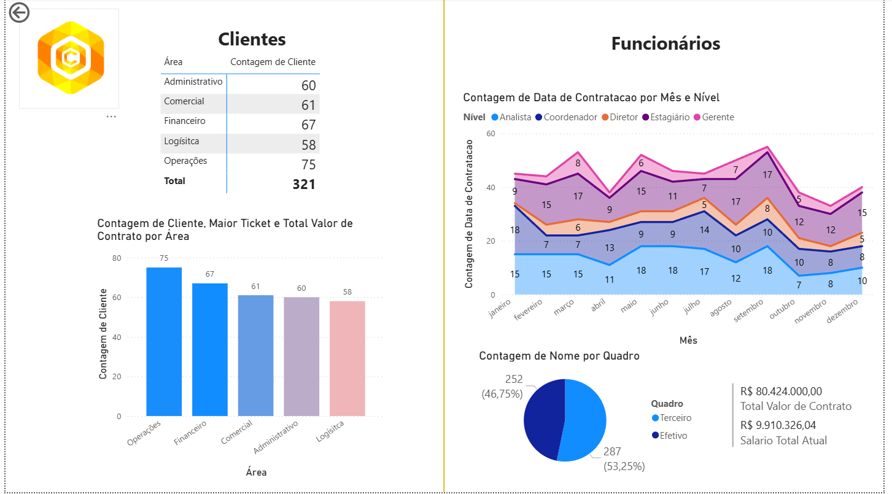
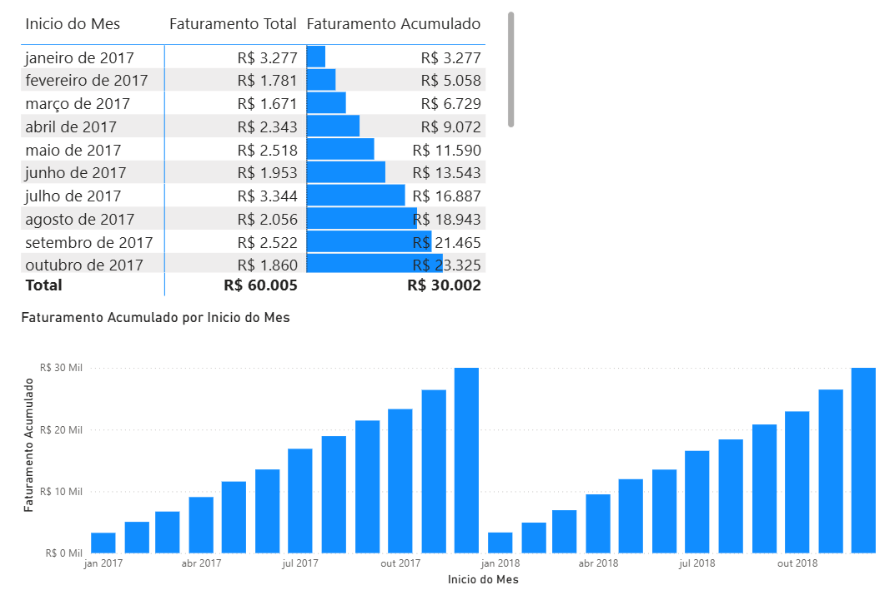
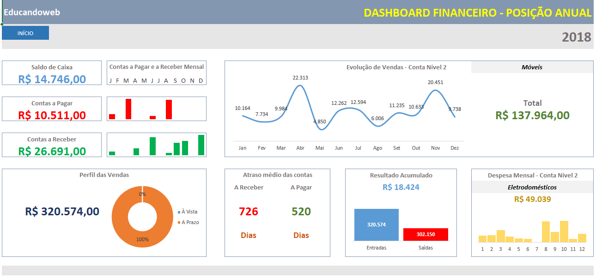
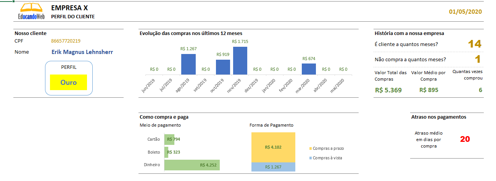

# Dashboards analíticos em Power BI e Excel

Coleção de cinco dashboards (dois em Power BI e três em Excel) que transformam bases de vendas, clientes, funcionários, fluxo de caixa e carteira de investimentos em indicadores para tomada de decisão.

## Problema que resolve e para quem

Gestores e analistas de pequenas e médias empresas costumam ter os dados em planilhas soltas e precisam de uma visão rápida do negócio: faturamento e metas, perfil de clientes, quadro de funcionários, saldo de caixa e evolução de investimentos. Cada projeto deste repositório organiza uma dessas bases em um painel com KPIs, filtros e gráficos, para quem precisa acompanhar o resultado sem montar análises do zero. Os dados são fictícios, de bases de exemplo.

## Tecnologias utilizadas

- **Power BI Desktop:** modelagem de dados, medidas DAX (inteligência de tempo, acumulados, variação percentual, metas), segmentações e mapas.
- **Excel avançado:** fórmulas, gráficos, cartões de indicadores, listas suspensas para filtro e menu de navegação entre abas.

## Projetos

| Pasta | Ferramenta | Arquivo | O que mostra |
| --- | --- | --- | --- |
| `BI-kip/` | Power BI | `KPI.pbix` | Faturamento mensal (2017–2018), comparação com o mesmo mês do ano anterior, crescimento sobre o mês anterior, faturamento acumulado e cartão de faturamento x meta com segmentação por período |
| `BI-relatorio-funcionarios/` | Power BI | `Relatório Funcionários.pbix` | Clientes por área (contagem e valor de contrato), clientes por nível, ticket médio, maior contrato; contratações por mês e nível, quadro efetivo x terceiro, salário total, impostos e mapa de funcionários por região do Brasil |
| `projeto-fluxo-de-caixa/` | Excel | `Projeto Fluxo de Caixa.xlsx` | Menu com cadastros (plano de contas de entradas e saídas, registros de caixa), relatórios (fluxo de caixa e resultado mensal, receitas, despesas, contas a pagar e a receber) e dois dashboards financeiros: posição atual e posição anual |
| `projeto-perfil-do-cliente-arquivos/` | Excel | `projeto-perfil-do-cliente-FINAL.xlsx` (+ `base-dados-1.xlsx`, `base-dados-2.xlsx`) | Ficha do cliente: categoria (ex.: Ouro), compras dos últimos 12 meses, tempo de relacionamento, valor total e médio, meio e forma de pagamento e atraso médio |
| `projeto-ativos-arquivos-excel/` | Excel | `projeto-ativos-FINAL.xlsx` (+ `base-de-dados-projeto-ativos.xlsx`) | Carteira de investimentos: valor atual, total aportado, valorização (R$ e %), composição do patrimônio (ações, FII e caixa) e ativos com maior valor e maior valorização, com filtro por tipo de ativo |

## Como executar

Pré-requisitos: Power BI Desktop (gratuito, Windows) para os arquivos `.pbix` e Microsoft Excel para os `.xlsx`.

1. Clone o repositório ou baixe os arquivos pelo GitHub:

   ```bash
   git clone https://github.com/FelipeGA02/Advanced-Dashboards-Power-BI-Excel.git
   ```

2. Power BI: abra `BI-kip/KPI.pbix` ou `BI-relatorio-funcionarios/Relatório Funcionários.pbix` no Power BI Desktop e use as segmentações (período, área, região) para filtrar.
3. Excel: abra o arquivo `*-FINAL.xlsx` (ou `Projeto Fluxo de Caixa.xlsx`) de cada pasta. Nos projetos de perfil do cliente e de ativos, mantenha as bases de dados na mesma pasta do arquivo final. No fluxo de caixa, navegue pelo menu da aba inicial.

## Minha contribuição

Projeto individual: código, modelagem e documentação de minha autoria.

## Demonstração

**Power BI — relatório de clientes e funcionários**



**Power BI — KPIs de faturamento (acumulado no ano)**



**Excel — dashboard financeiro (posição anual)**



**Excel — perfil do cliente**



Outras capturas: `BI-kip/exemple1.png` e `exemple2.png`, `BI-relatorio-funcionarios/exemple2.png` e `exemple3.png` (mapa), `projeto-fluxo-de-caixa/exemple1.png` (menu) e `exemple2.png` (posição atual), `projeto-ativos-arquivos-excel/exemple1.png` (carteira).
